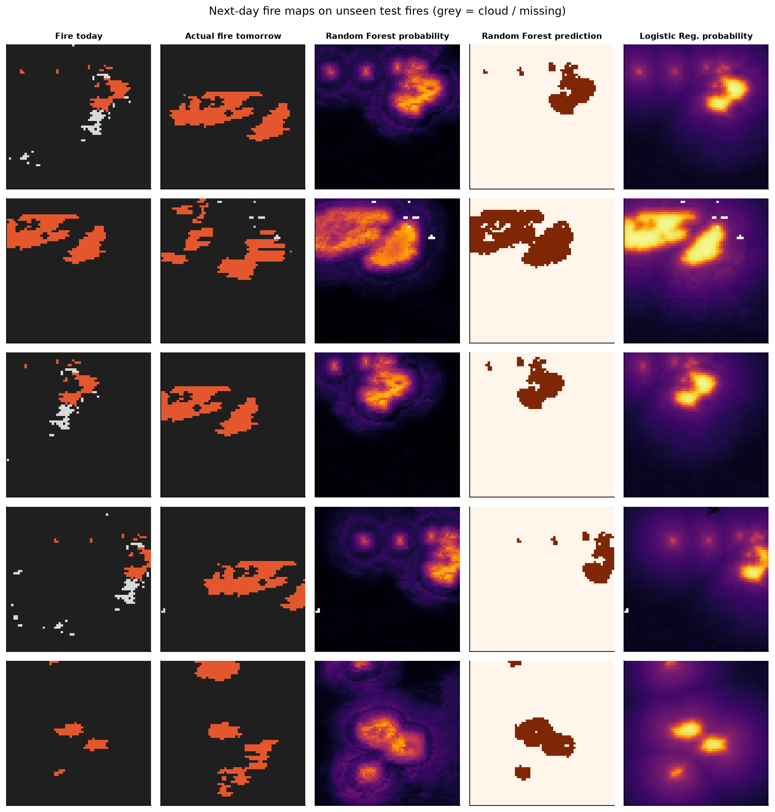

# 🔥 FireSight: Predicting Next-Day Wildfire Spread from Google Earth Engine Data

Satellites show where a wildfire burns **today**. FireSight predicts where it will burn **tomorrow**.
It uses 18,545 real fires whose satellite and weather layers were built in Google Earth Engine,
24 physics-informed features, five tuned ML models and an interactive **digital twin** for wind and
climate-warming what-if scenarios.

**Live demo:** LIVE_URL · **Paper:** [`paper/FireSight_Paper.pdf`](paper/FireSight_Paper.pdf) · **Slides:** [`slides/FireSight_Slides.pdf`](slides/FireSight_Slides.pdf) · **Notebook:** [`FireSight.ipynb`](FireSight.ipynb)

## Results (6.7 million unseen test pixels, 1.25% fire)

| Model | Precision | Recall | F1 | AUC-PR | ROC-AUC |
|---|---|---|---|---|---|
| Persistence baseline | 0.357 | 0.273 | 0.309 | 0.107 | 0.633 |
| Logistic Regression | 0.272 | 0.453 | 0.340 | 0.227 | **0.901** |
| **Random Forest** | 0.264 | **0.491** | **0.343** | **0.258** | 0.875 |
| XGBoost | 0.258 | 0.445 | 0.326 | 0.228 | 0.866 |
| LightGBM | 0.237 | 0.465 | 0.314 | 0.215 | 0.845 |
| MLP (Neural Net) | 0.198 | 0.362 | 0.256 | 0.116 | 0.790 |

* The engineered features raise Random Forest AUC-PR by **58%** (0.163 → 0.258).
* Our Random Forest (25.8% AUC-PR) beats the original paper's Random Forest (22.5%) on a laptop CPU.
* Digital twin: predicted area at risk grows **+7.5% at +2 °C** and **+20.4% at +4 °C**.



## Project structure

```
FireSight.ipynb            end-to-end notebook (EDA → models → evaluation → SHAP → digital twin)
src/
  config.py                paths, variables, clipping ranges
  data.py                  download + load the dataset, build pixel tables
  features.py              cleaning and the 12 engineered features
  eda.py                   summary statistics and EDA figures
  train.py                 tuning (RandomizedSearchCV + GroupKFold) and evaluation of 5 models
  report.py                tables, curves, confusion matrix, ablation, SHAP, maps
  twin.py                  digital twin scenarios (wind, +2 °C, +4 °C)
gee/export_fire_features.js  Google Earth Engine script to build the inputs for any region (e.g. Pakistan)
tests/test_features.py     unit tests for the feature engineering
paper/                     research paper (HTML source + PDF) and PaperOrchestra raw materials
slides/                    presentation (HTML source + PDF)
site/                      website with the interactive digital twin
outputs/                   results.json, tables, figures
```

## Run it

```bash
python3.12 -m venv .venv && source .venv/bin/activate
pip install -r requirements.txt
python -m src.eda      # downloads the data (~1.6 GB) on first run, writes EDA figures
python -m src.train    # ~40 min on a laptop CPU
python -m src.report   # result figures + SHAP
python -m src.twin     # digital twin scenarios
pytest -q              # feature tests
```

`python -m src.data` is not needed: `src.eda` and `src.train` call `download()` first.

## Dataset

**Next Day Wildfire Spread** (Huot et al., IEEE TGRS 2022): 18,545 US fire events, 2012–2020, 64 × 64 km tiles at 1 km.
It was built in Google Earth Engine from MODIS fire masks, VIIRS NDVI, SRTM elevation, GRIDMET weather and drought, and GPWv4 population.
Sources: [Kaggle](https://www.kaggle.com/datasets/fantineh/next-day-wildfire-spread) · [Hugging Face zarr copy](https://huggingface.co/datasets/TheRootOf3/next-day-wildfire-spread) (used here, no login needed). License CC BY 4.0.

## Author

Burhan Khatri, Data Science Course Project.
